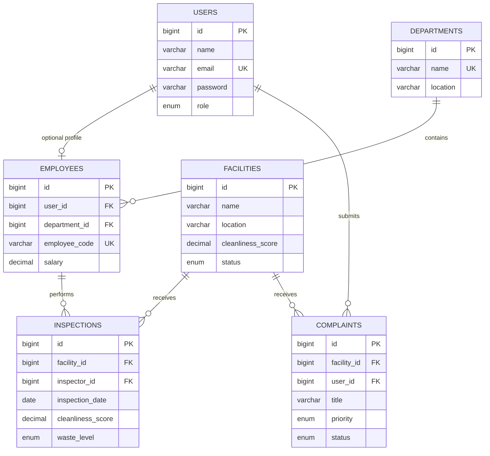

# Entity Relationship Diagram

## Relationship explanation
- A department has many employees; each employee belongs to one department.
- A user can optionally have one employee profile; an employee profile can reference one user.
- A facility has many inspections; each inspection belongs to one facility.
- An employee can perform many inspections; each inspection has one inspector.
- A facility has many complaints; each complaint belongs to one facility.
- A user can submit many complaints; each complaint has one submitting user.
